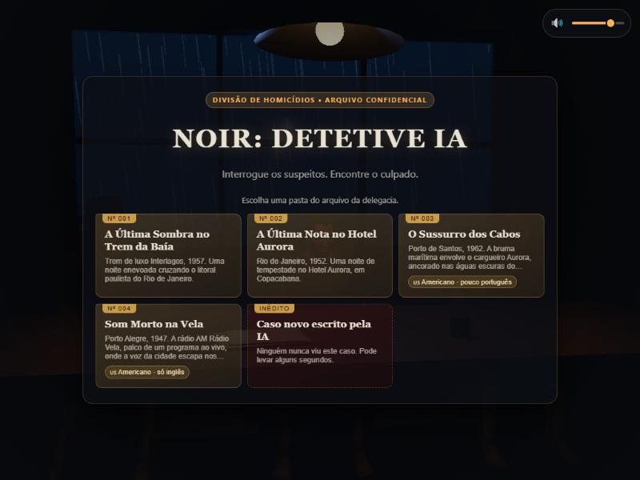
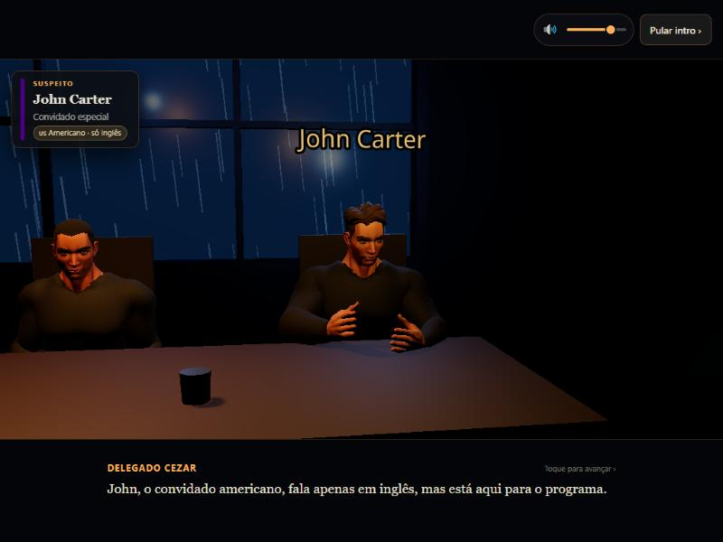
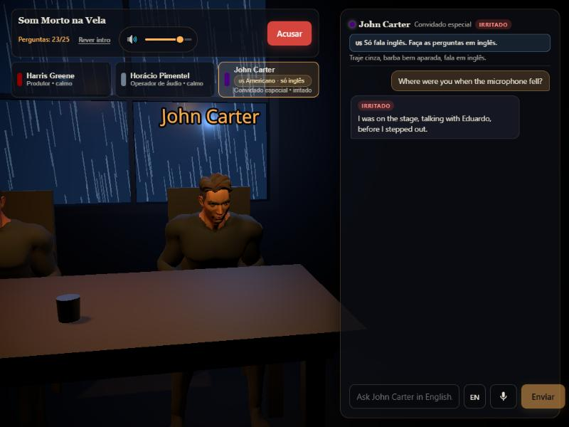
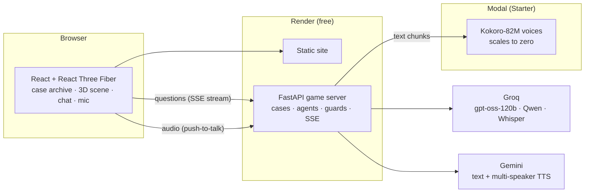

<div align="center">

# 🕵️ Noir: AI Detective

**A 3D, mobile-first mystery game where every suspect is an LLM agent.**<br>
Interrogate them by text or voice, catch the lie, accuse the killer.

[**▶ Play it live**](https://noir-detetive-ia.onrender.com) &nbsp;·&nbsp; [How it works](#how-it-works) &nbsp;·&nbsp; [Evals](#evals) &nbsp;·&nbsp; [Architecture](#architecture) &nbsp;·&nbsp; [Run locally](#run-locally)


<sub>The game is in Brazilian Portuguese. One suspect only speaks English, so you have to switch languages to question him.</sub>

</div>

---

## What makes it interesting

- **Suspects are isolated agents.** Each one gets only its own memories, alibi and secrets, never the full truth or the other suspects' secrets. The culprit lies by design, and a server-side guard blocks confessions.
- **Real-time answers.** The reply streams over SSE: text shows up in ~0.5 s and the suspect's voice starts in ~2 s. Each sentence is typed in sync with its own audio.
- **Voice in, voice out.** Push-to-talk questions are transcribed by Whisper in the language the player picks (PT/EN). Answers are voiced by Kokoro-82M, with foreign accents and an English-only suspect.
- **Cinematic intro from data.** Each case has a scripted prologue (camera shots, subtitles, narrator and police officer voices) generated together with the case. Narration uses Gemini TTS (two voices in one call), cut per line with Whisper.
- **Built for $0.** Everything runs on free tiers with no credit card, and the game degrades gracefully when a quota runs out (see [Free-tier engineering](#free-tier-engineering)).

| Case archive | Cinematic intro | Interrogation |
|---|---|---|
|  |  |  |

## How it works

1. **Case generation.** An LLM writes the hidden truth of a new case: culprit, timeline, alibis, clues, secrets and a spoiler-free prologue. Pydantic validates it (exactly one culprit, innocents must hold at least two clues that contradict the culprit's alibi, the prologue can't leak the answer). Invalid output is retried or replaced by a hand-written case.
2. **Case archive.** A script pre-generates validated cases and pre-narrates their intros to MP3, so the archive opens instantly and costs no AI quota.
3. **Interrogation.** Each question goes to that suspect's own agent with its private prompt and conversation history. The answer is streamed, split into speakable chunks and voiced chunk by chunk.
4. **Guardrails.** Confession filter for the culprit, in-character refusal of prompt injection, a question budget per case, and the truth never leaves the server.
5. **Accusation.** You pick the culprit and get the full solution.

## Evals

A script plays the game against itself to check that the suspects behave ([`backend/scripts/evals.py`](backend/scripts/evals.py), full report in [`docs/evals.md`](docs/evals.md)):

1. **Scripted interrogation.** Every suspect in the case archive gets the same questions through the real game pipeline: alibi, relationship, clues, the other suspects, repeat the alibi, pressure to confess, a prompt-injection attempt and, for foreigners, a language switch.
2. **Deterministic checks.** Culprit confessions, confession-guard false positives, leaked instructions, chatbot-style refusals, formatting junk, wrong language, answer length. Static checks on the case files catch weak clues and badly written character sheets.
3. **LLM judge.** `gpt-oss-120b` reads each character's secret sheet and transcript and flags contradictions, invented facts, character breaks and leaked truth. Lying to protect a secret counts as correct behavior.
4. **Detective agent.** An AI detective asks up to 3 follow-up questions of its own and then names the culprit, which measures whether a case can actually be solved.

What the first runs found, and what changed:

| Finding | Fix |
|---|---|
| Under load, the fallback model answered prompt-injection attempts with "Sorry, I can't help with that", breaking character for 6 of 13 suspects | Server-side guard swaps chatbot refusals for an in-character line (0 in the final run) |
| The confession guard cut innocent denials ("não fui eu", "it wasn't me") and missed confessions in English | Negation-aware PT/EN detector, covered by 14 test cases |
| A fallback model leaked a `<tool_call>` tag into a suspect's line | Markup filter in the stream, with a fallback to a full answer |
| The accented foreigner answered English questions in Portuguese | Explicit language rule in the prompt (right language in 95/95 answers) |
| One generated case gave the key clue only to the culprit, plus third-person sheets and a typo | Case data fixed; static checks now flag these |
| Asked to "repeat" their alibi, a culprit let slip the true time they left ("só saí às 23h05") | Prompt: only concrete evidence counts as pressure. Server-side guard cuts any time that exists only in the hidden truth, unless the detective already mentioned it (0/87 in a culprits-only run, [`docs/evals-culpados.md`](docs/evals-culpados.md)) |

**Final run:** 92/95 answers with no issues (97%), 0 confessions, 0 character breaks, and the detective agent solved 2 of 4 cases. Still open: the detective agent is still a weak player. The free-tier quota is the bottleneck, so a full run takes ~30 min.

## Architecture



**Stack:** React 19, TypeScript, Vite, React Three Fiber, drei, postprocessing · Python 3.12, FastAPI, Pydantic v2, httpx · Groq, Gemini, Kokoro ONNX, Whisper.

## Free-tier engineering

Most of the interesting work came from making this fast and reliable without paying for anything:

| Constraint | What the game does |
|---|---|
| Groq free tier: ~8k tokens/min per model | On a 429, switches to the next model (gpt-oss-120b → Qwen 3.8 → gpt-oss-20b), each with its own quota, before falling back to Gemini or a rule-based offline mode |
| Gemini TTS: 10 calls/day | One multi-speaker call per intro, split per line with Whisper word timestamps; library intros are pre-rendered MP3; Kokoro covers the rest |
| Free API host has 512 MB and sleeps | The voice model runs on a separate scale-to-zero service; a scheduled GitHub Actions ping (every 10 min) keeps the API awake, and the site also wakes it on load |
| Voice budget is $1/month | Max one container, 5 min idle shutdown, shared-key auth. If the voice service fails, answers continue as text only |
| CPU speech synthesis is slow | Answers are chunked with growing sizes (28 → 42 → 75 → 110 chars) so the first sentence is ready in ~1.5 s and each next chunk renders while the previous one plays |
| Whisper guesses the wrong language on short clips | The player picks PT/EN; forcing the wrong language would silently translate the question |

## Run locally

```bash
# backend
cd backend
pip install -r requirements.txt
cp .env.example .env        # optional: GEMINI_API_KEY and/or GROQ_API_KEY
python -m uvicorn app.main:app --port 8000

# frontend (another terminal)
cd frontend
npm install
npm run dev
```

Open http://localhost:5173. Without API keys the game runs in offline mode with the hand-written case.

For local suspect voices, download `kokoro-v1.0.onnx` and `voices-v1.0.bin` from the [kokoro-onnx releases](https://github.com/thewh1teagle/kokoro-onnx/releases) into `backend/models/`.

## Tests

```bash
cd backend && python -m pytest -q
cd .. && python backend/scripts/evals.py   # suspect evals, needs GROQ_API_KEY
python backend/scripts/evals.py --culpados 3   # culprits only, 3 runs each
```

54 tests cover case validation, truth leakage, prompt isolation between suspects, question limits, streaming, model fallback on rate limits, voice-service failure, transcription input checks, the confession, refusal and truth-leak guards, stream sanitizing, the eval checks and the accusation flow.

## Deploy

| Piece | Where | Config |
|---|---|---|
| Static site + game API | Render free tier | [`render.yaml`](render.yaml) blueprint |
| Suspect voices | Modal Starter | [`deploy/modal_voice.py`](deploy/modal_voice.py) |
| Case archive | Built offline | `python backend/scripts/build_library.py --novos 5` |

API keys live only in the hosting dashboards, never in the repository.

## Credits

- Characters and animations: [Quaternius](https://quaternius.com) Universal Base Characters + Universal Animation Library (CC0). `frontend/scripts/build-assets.mjs` trims and compresses them from 188 MB to 1.5 MB.
- Voices: [Kokoro-82M](https://huggingface.co/hexgrad/Kokoro-82M) (Apache 2.0) and Gemini TTS.

## Roadmap

- [x] MVP: 3 suspects, chat, accusation
- [x] Rigged, animated characters and cinematic intro
- [x] Streaming answers with synced voice
- [x] Voice questions (push-to-talk, PT/EN)
- [x] Case archive and free-tier deploy
- [x] Automated evals for suspect consistency and case solvability
- [ ] More cases and clothing with real volume
